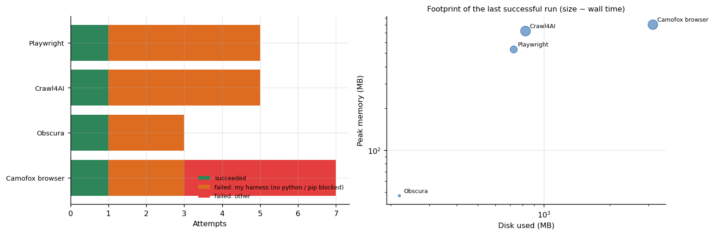

# Web automation lab

**Playwright, Crawl4AI, Obscura and a Firefox-based browser (against a public bot-detection page) installed and exercised in a disposable sandbox, with every attempt, failure and footprint kept.** The point is a verified starting kit for scraping and browser automation and an honest account of what it took to get each tool to run.



## Why this matters

Browser automation is the layer under most data-collection and agent projects, and the first week with it is usually spent on installation, not on the task. This lab runs each tool in an isolated `HOME` on a small CPU instance, records exit status, wall time, peak memory and disk, and keeps the script of every test (`src/tools/*.sh`), so a reader can see exactly what "it works" meant. It also shows how much of the apparent failure rate was the test harness itself: 12 of the 20 attempts for these tools were lost to a missing `python` command or a `pip` blocked by the system Python, none of which says anything about the tools.

## What each test measured

| Tool | Test | Result |
|---|---|---|
| Playwright | 5 loads of example.com in headless Chromium, median navigation time | **24 ms**; whole script 71 s, 532 MB peak memory, 728 MB disk |
| Crawl4AI | crawl example.com and a Python documentation page to markdown | **0.71 s** and **0.98 s**; the docs page became 46,073 characters of markdown; 722 MB peak memory |
| Obscura (headless browser binary) | fetch example.com and evaluate the page title | **290 ms** median; 47 MB peak memory, a single small binary |
| Camofox (Firefox-based) | open the public bot-detection page `bot.sannysoft.com` once | ran after 132 s; the harness counted 3 failed checks for plain Playwright on the same page. Used only against that public test page |

**These numbers are not a ranking.** They measure different jobs on trivial pages (24 ms for a page load in an already running browser, 710 ms for a crawl that also converts to markdown). The only valid comparison is within a tool: Crawl4AI's time grew by 38% from the trivial page to the documentation page while its output grew roughly 48-fold.

## What it took

4 of 4 tools ran. Of 20 attempts, 4 succeeded; 12 failures were harness problems, 4 were something else (a missing system library for the Firefox-based browser, for example). `results/tables/failure_classes_by_tool.md` lists them. Lesson for the next suite: run the harness on two or three trivial tools first and read their logs before launching everything.

## Repository map

```
src/sandbox/sandbox_suite.py   the harness: isolated HOME, time limit, peak RSS sampling, disk, METRIC line parsing
src/tools/*.sh                 the exact test script of each tool above
analysis/tools_report.py       attempts, failure classes, footprints, figures
data/                          sandbox_attempts.csv, sandbox_metrics.csv
```

## Reproduce

```bash
make setup && make all
python src/sandbox/sandbox_suite.py playwright crawl4ai obscura      # on a Linux machine with Python 3.12 and Node; writes results.jsonl
```

## Limits

Success means exit status 0 of a script I wrote; it is not a judgement of quality, safety or licence. Pages were trivial or public; no anti-bot protection was tested beyond the public detector page, and **no scraping of third-party sites** is part of this repository. Memory is sampled twice a second, so peaks are lower bounds. Disk counts the tool's own directory and home, not system installs.

## Articles that use this repository

- [Eighty-three open tools in a disposable sandbox](https://www.kaggle.com/code/lucasrangelss/eighty-three-open-tools-in-a-disposable-sandbox): the full suite, failure classes and footprints
- Related: [agent-tooling-token-savings](https://github.com/LucasRangelSSouza/agent-tooling-token-savings), [app-platforms-smoke-tests](https://github.com/LucasRangelSSouza/app-platforms-smoke-tests), [vast-gpu-benchmark-harness](https://github.com/LucasRangelSSouza/vast-gpu-benchmark-harness)

Licence: MIT for this code; see `LICENSE_NOTES.md` for each tool.
